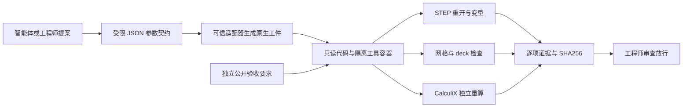

# 架构与复现

Web 服务使用 Python 标准库，绑定 localhost。至多同时执行两个原生容器、四个排队/执行任务。原生作业关闭网络，根文件系统只读，代码目录只读，单次输出目录可写，限制 CPU/内存/进程数和 600 秒时限。

这是桌面研究原型的边界，不应直接暴露到公网。HTTP Origin 检查不是用户认证。任意用户上传、租户隔离、持久队列、用户鉴权和审签均尚未实现。

工具主版本：Ubuntu 24.04、Python 3.12、CadQuery 2.8.0 / OCP 7.9.3.1.1、Ubuntu Gmsh 4.12.1、CalculiX 2.21、meshio 5.3.5、NumPy 2.5.4。Dockerfile 锁定关键工具版本；基础镜像和传递依赖尚非完全 hermetic，精确的本次镜像标识记录于交付证据。
